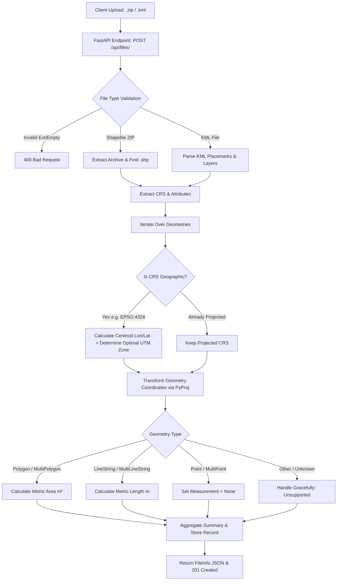

# 🌍 Geospatial File Measurement API

A production-grade backend service built with **FastAPI**, **GeoPandas**, **Shapely**, and **PyProj** that accepts geospatial files (**ESRI Shapefile ZIP archives** and **KML files**), processes geometric features, handles Coordinate Reference System (CRS) transformations dynamically to eliminate geodesic distortion, and computes accurate metric measurements (Area for Polygons, Length for LineStrings).

---

## 📋 Table of Contents
- [Features](#-features)
- [Project Architecture & Structure](#-project-architecture--structure)
- [File Processing & CRS Handling Flow](#-file-processing--crs-handling-flow)
- [Local Setup & Installation](#-local-setup--installation)
- [API Documentation & Examples](#-api-documentation--endpoints)
  - [1. Upload Geospatial File (`POST /api/files/`)](#1-upload-file)
  - [2. Get File Information (`GET /api/files/{id}/`)](#2-get-file-information)
  - [3. Get Feature Measurements (`GET /api/files/{id}/measurements/`)](#3-get-feature-measurements)
  - [4. List All Uploaded Files (`GET /api/files/`)](#4-list-all-files)
  - [5. Delete File (`DELETE /api/files/{id}/`)](#5-delete-file)
- [Testing](#-running-tests)
- [Design Decisions & Trade-offs](#-design-decisions)
- [Key Learnings & Future Scope](#-learnings--future-scope)

---

## ✨ Features

- 📦 **Multi-Format Ingestion**: Supports `.zip` containing complete Shapefiles (`.shp`, `.shx`, `.dbf`, `.prj`) and `.kml` files.
- 🌐 **Dynamic CRS & UTM Transformation**: Unprojected geographic coordinates (e.g. `EPSG:4326` WGS84) are dynamically converted into optimal local Universal Transverse Mercator (UTM) metric projections before measurement, preventing angular degree calculation errors.
- 📐 **Accurate Metric Measurements**:
  - **Polygon / MultiPolygon**: Calculates Area in square meters ($m^2$), with converted units (hectares, $km^2$, acres).
  - **LineString / MultiLineString**: Calculates Length in meters ($m$), with converted units ($km$, miles, feet).
  - **Point / MultiPoint**: Gracefully handled with descriptive metadata.
  - **Unsupported Geometries**: Handled safely without server crashes or 500 errors.
- ⚡ **High Performance & Type Safety**: Built with FastAPI, Pydantic v2 validation, and Swagger UI interactive documentation.
- 🧪 **Full Test Coverage**: Automated integration and unit tests using `pytest` and `httpx`.

---

## 🏛️ Project Architecture & Structure

```text
geospatial-measurement-api/
├── app/
│   ├── __init__.py
│   ├── main.py                  # FastAPI application entrypoint & middleware
│   ├── config.py                # App configuration & environment settings
│   ├── models/
│   │   ├── __init__.py
│   │   └── schemas.py           # Pydantic data validation models & response schemas
│   ├── services/
│   │   ├── __init__.py
│   │   ├── crs_transformer.py   # Dynamic UTM zone calculation & CRS projection
│   │   ├── measurement.py       # Area/Length geometric metric engine
│   │   └── file_processor.py   # Shapefile (.zip) and KML parsing services
│   ├── routers/
│   │   ├── __init__.py
│   │   └── files.py             # REST API routes for upload & measurements
│   └── storage/
│       ├── __init__.py
│       └── db.py                # Thread-safe file & measurement repository
├── sample_data/
│   ├── create_sample_files.py   # Script to generate sample geospatial files
│   ├── sample_polygon.kml       # Sample Polygon KML
│   ├── sample_linestring.kml    # Sample LineString KML
│   ├── sample_points.kml        # Sample Points KML
│   ├── sample_survey_mixed.kml  # Sample Multi-geometry KML
│   └── sample_shapefile.zip     # Sample ESRI Shapefile ZIP
├── tests/
│   ├── __init__.py
│   ├── conftest.py              # Pytest fixtures and TestClient configuration
│   ├── test_api.py              # API endpoint integration test suite
│   └── test_processor.py        # CRS transformation and measurement unit tests
├── requirements.txt             # Python dependencies
├── Dockerfile                   # Production containerization
├── .env.example                 # Sample environment variables
└── README.md                    # Project documentation
```

---

## 🔄 File-Processing & Measurement Calculation Flow



### CRS Handling Strategy
Calculating area or length directly on unprojected geographic coordinates (latitude and longitude in degrees) leads to severely distorted results because 1 degree of longitude varies dramatically depending on latitude.

**Strategy Implemented:**
1. Check if the layer/feature's coordinate reference system is projected using `pyproj.CRS.is_projected`.
2. For geographic CRS (e.g. `EPSG:4326`), calculate the geometric centroid $(\text{lon}, \text{lat})$.
3. Compute the optimal **Universal Transverse Mercator (UTM) Zone**:
   $$\text{Zone} = \left\lfloor \frac{\text{lon} + 180}{6} \right\rfloor + 1$$
   - Northern Hemisphere ($\text{lat} \ge 0^\circ$): `EPSG:32601` – `EPSG:32660`
   - Southern Hemisphere ($\text{lat} < 0^\circ$): `EPSG:32701` – `EPSG:32760`
4. Apply standard 2D conformal cartographic transformation using `pyproj.Transformer` with `always_xy=True`.
5. Execute exact metric area ($m^2$) and length ($m$) calculations on the projected Shapely geometry.

---

## 🚀 Local Setup & Installation

### Prerequisites
- Python 3.10+ (tested on Python 3.12)
- `pip` package manager

### 1. Clone & Set Up Environment
```bash
# Clone the repository
git clone https://github.com/<your-username>/geospatial-measurement-api.git
cd geospatial-measurement-api

# Create and activate virtual environment
python -m venv venv

# On Windows:
venv\Scripts\activate

# On Linux / macOS:
source venv/bin/activate
```

### 2. Install Dependencies
```bash
pip install -r requirements.txt
```

### 3. Generate Sample Geospatial Files (Optional)
```bash
python sample_data/create_sample_files.py
```

### 4. Run the Application
```bash
uvicorn app.main:app --host 0.0.0.0 --port 8000 --reload
```
The API will be live at: **`http://localhost:8000`**
- Interactive Swagger UI: **`http://localhost:8000/docs`**
- Interactive ReDoc: **`http://localhost:8000/redoc`**

---

## 📡 API Documentation & Endpoints

### 1. Upload File
**`POST /api/files/`**

Accepts `multipart/form-data` with key `file` containing a `.zip` (Shapefile) or `.kml` file.

#### Example Request:
```bash
curl -X POST "http://localhost:8000/api/files/" \
  -H "accept: application/json" \
  -H "Content-Type: multipart/form-data" \
  -F "file=@sample_data/sample_polygon.kml"
```

#### Example Response (`201 Created`):
```json
{
  "id": "7b8e1a90",
  "filename": "sample_polygon.kml",
  "feature_count": 1,
  "crs": "EPSG:4326",
  "status": "COMPLETED",
  "created_at": "2026-10-09T11:27:00.123456Z",
  "error_message": null
}
```

---

### 2. Get File Information
**`GET /api/files/{id}/`**

Retrieves metadata and processing status for an uploaded file.

#### Example Request:
```bash
curl -X GET "http://localhost:8000/api/files/7b8e1a90/"
```

#### Example Response (`200 OK`):
```json
{
  "id": "7b8e1a90",
  "filename": "sample_polygon.kml",
  "feature_count": 1,
  "crs": "EPSG:4326",
  "status": "COMPLETED",
  "created_at": "2026-10-09T11:27:00.123456Z",
  "error_message": null
}
```

---

### 3. Get Feature Measurements
**`GET /api/files/{id}/measurements/`**

Returns individual feature measurements (Area/Length), attributes, geometries, and file-level aggregated statistics.

#### Example Request:
```bash
curl -X GET "http://localhost:8000/api/files/7b8e1a90/measurements/"
```

#### Example Response (`200 OK`):
```json
{
  "id": "7b8e1a90",
  "filename": "sample_polygon.kml",
  "feature_count": 1,
  "crs": "EPSG:4326",
  "status": "COMPLETED",
  "features": [
    {
      "feature_id": 0,
      "geometry_type": "Polygon",
      "crs": "EPSG:4326",
      "projected_crs": "EPSG:32618",
      "properties": {
        "name": "Central Park Reservoir Perimeter",
        "description": "Reservoir enclosure"
      },
      "geometry": {
        "type": "Polygon",
        "coordinates": [
          [
            [-73.962, 40.785],
            [-73.957, 40.785],
            [-73.957, 40.781],
            [-73.962, 40.781],
            [-73.962, 40.785]
          ]
        ]
      },
      "measurement": {
        "type": "area",
        "value": 187212.45,
        "unit": "square_meters",
        "formatted": "187,212.45 m²",
        "conversions": {
          "hectares": 18.7212,
          "square_kilometers": 0.187212,
          "acres": 46.2611
        },
        "note": "Calculated in projected metric CRS: EPSG:32618"
      }
    }
  ],
  "summary": {
    "total_area_sq_m": 187212.45,
    "total_length_m": 0.0,
    "geometry_types_breakdown": {
      "Polygon": 1
    },
    "total_features_measured": 1
  }
}
```

---

### 4. List All Files
**`GET /api/files/`**

```bash
curl -X GET "http://localhost:8000/api/files/"
```

---

### 5. Delete File
**`DELETE /api/files/{id}/`**

```bash
curl -X DELETE "http://localhost:8000/api/files/7b8e1a90/"
```

---

## 🧪 Running Tests

A comprehensive test suite covering unit calculation logic, coordinate transformations, file formats, and API status codes is included:

```bash
# Run pytest with verbose output
python -m pytest -v
```

Output:
```text
tests/test_api.py::test_root_endpoint PASSED
tests/test_api.py::test_upload_kml_polygon PASSED
tests/test_api.py::test_upload_shapefile_zip PASSED
tests/test_api.py::test_upload_invalid_extension PASSED
tests/test_api.py::test_upload_zip_without_shp PASSED
tests/test_api.py::test_get_nonexistent_file PASSED
tests/test_api.py::test_delete_file PASSED
tests/test_processor.py::test_utm_zone_calculation PASSED
tests/test_processor.py::test_polygon_area_measurement PASSED
tests/test_processor.py::test_linestring_length_measurement PASSED
tests/test_processor.py::test_point_measurement PASSED
tests/test_processor.py::test_empty_and_unsupported_geometry PASSED
======================= 12 passed in 0.27s =======================
```

---

## 💡 Design Decisions

1. **Framework Selection (FastAPI vs Django REST Framework)**:
   - **Choice: FastAPI**: Provides asynchronous high-throughput capabilities, native Pydantic v2 data serialization, automatic OpenAPI documentation, and minimal overhead for microservice architectures compared to full-stack Django.
2. **Dynamic UTM Zone Selection**:
   - Rather than relying on a single global projection (e.g. Web Mercator `EPSG:3857` which suffers from extreme area distortion near the poles), we dynamically calculate the optimal local UTM zone for each feature's centroid.
3. **Resilient Multi-Engine KML Parsing**:
   - Implemented a 3-tier parsing strategy: GeoPandas/Fiona $\rightarrow$ FastKML $\rightarrow$ Native XML Placemark Parser. This guarantees zero parsing failure even when KML files contain non-standard XML namespaces or schemas.
4. **Graceful Geometry Fallback**:
   - Geometries without meaningful 1D/2D metric dimensions (e.g. Points, MultiPoints, GeometryCollections) return informative responses instead of causing unhandled runtime exceptions.

---

## 🔬 Learnings & Future Scope

### Key Learnings
- **Geodesic vs Planar Projections**: Calculating distance/area in degrees produces incorrect results; reprojection to local UTM or equal-area projections is critical for domain-accurate GIS applications.
- **Shapefile Component Encapsulation**: ESRI Shapefiles require multi-part file bundling (`.shp`, `.shx`, `.dbf`, `.prj`); handling them in memory/temporary isolated workspaces ensures clean cleanup.

### Future Scope
- **Asynchronous Task Queue (Celery / Redis / BackgroundTasks)**: For massive GIS datasets (>500MB or millions of vertices), offload file ingestion to background workers with WebSocket progress updates.
- **Cloud Object Storage (AWS S3 / GCP GCS)**: Persist uploaded raw files and geometries in cloud storage with signed URLs.
- **GeoJSON & GeoPackage Ingestion**: Extend support to `.geojson`, `.gpkg`, and `.geotiff` raster zonal statistics.
- **Spatial Indexing & PostGIS**: Integrate PostgreSQL + PostGIS with spatial indexing (`GIST`) for high-performance spatial querying (e.g. bounding box filters, buffer analysis).
